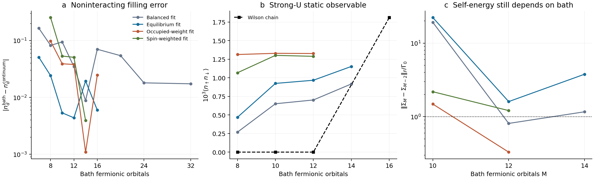

# Optimized passive matrix-bath test — 28 October 2026

The tested bath compression improves selected static quantities, but **does not establish convergence of the interacting matrix self-energy or an exceptional point**. The central finding is that near-identical total occupancy can conceal appreciable changes in spin direction and in the self-energy.

## Model and scope

All calculations use the same full Hermitian rotating-frame radial bath as the previous tests: SOC 0.05, W = 0.1, VO = 1.2134220096136235, auxiliary energy 120, rotation frequency 60, cutoff π/4 and μ = 0.012. The U=0 filling benchmark uses εd = 0.0151703497834. Its analytic-continuum reference is nd = 0.962817293231. The occupied interacting reference uses U = 0.2 and εd = 0.0151703497834 − U/2 = −0.0848296502166. This gate shift is a chosen path; the asymmetric bath does not make it an exact particle-hole-symmetric point.

The finite interacting systems are solved in complete relevant charge sectors, with no NRG state truncation. Repulsive-U lower bounds exclude other charge sectors; the solver does not silently skip large sectors. At fixed controls, every tested optimized bath has real energies and positive-semidefinite matrix residues. One rank-one bath pole is one fermionic bath orbital. A Wilson block contains two such fermionic degrees of freedom. Do not compare these counts as if they were equal.

The final Green-function diagnostic embeds the finite-bath interaction self-energy into the analytic physical-sheet continuum hybridization, as in the prior package. This remains an embedding approximation. No complex pole search or outgoing-sheet interaction certificate was attempted in this test because the physical-sheet convergence checks remain insufficient.

## Bath construction and independent checks

We parameterize Δfit(ζ) = Σl vl vlᵀ/(ζ − εl), with real εl and real two-component vl. Positive residues enforce passivity structurally; no artificial constant loss is introduced. The target is the full 2×2 hybridization, including both off-diagonal and diagonal components.

A full-band 8192-node microscopic quadrature supplies a Hermitian projection seed. Its hybridization agrees with the analytic bath to approximately 2×10⁻¹² on the fitting grid. The seed is formed from real/imaginary resolvent snapshots, together with the coupling vectors, and subsequently optimized using an analytic Jacobian. These are local nonlinear fits; no global-optimality theorem is claimed.

The training data use 64 imaginary-frequency points and 35 broadened real-frequency points. Validation uses 91 different imaginary-frequency points, 101 different real-frequency points at broadenings 0.001, 0.003 and 0.01, and four independent U=0 impurity-level/hybridization benchmarks. Total zeroth and first bath moments enter as penalties. Four fitting choices were tested:

- Balanced: relative real-frequency weight 0.55, smallest imaginary frequency 0.0002.
- Equilibrium: real-frequency weight 0.05, smallest imaginary frequency 0.0001.
- Occupied-weight: real-frequency weight 0.15, with additional occupied zeroth/first spectral-moment penalties. These moments are integrated by splitting the radial integral exactly at the two Fermi crossings.
- Spin-weighted: the occupied-weight objective with an eightfold weight on the traceless Pauli components of the bath. This tests sensitivity to spin-dependent fit errors.

The occupied-weight penalties are soft constraints; their remaining residuals are in the fit JSON. The word `exact` in the corresponding filenames distinguishes the refined reference moment integration, not an exact finite-bath representation. Splitting the occupied integral and increasing its quadrature order from 128 to 256 changes its moments by relative [2.265050034848135e-14, 1.0186449747078841e-13]. A single global radial grid has small step-integration errors, recorded separately.

## Results

| Fit family, 12 bath orbitals | U=0 filling | U=0.2 filling | U=0.2 double occupancy | 10→12 self-energy change / Γ0 |
|---|---:|---:|---:|---:|
| Balanced fit | 0.92800936 | 0.99372765 | 0.000701738 | 0.8098 |
| Equilibrium fit | 0.96719831 | 0.99374321 | 0.000967236 | 1.6043 |
| Occupied-weight fit | 0.92482483 | 0.99405225 | 0.001326984 | 0.3299 |
| Spin-weighted fit | 1.01353638 | 0.99403296 | 0.001289217 | 1.2103 |


For the equilibrium fits, the U=0 fillings at 10 and 12 bath orbitals are 0.96816935 and 0.96719831, appreciably closer to 0.96281729 than several previous short Wilson-chain values. This is useful improvement, but it is not uniform convergence. Other fitting weights move the answer, increasing the bath size can change it nonmonotonically, and the independent frequency checks still show substantial errors.

For example, the 12-orbital equilibrium fit has about 6.0% RMS relative error on the held-out imaginary-frequency grid and about 35% in the resonance-window hybridization at broadening 0.003. The 32-orbital balanced fit reduces the corresponding resonance-window error to about 2.1%, but its U=0 filling remains about 0.94545. A good fit to one diagnostic does not establish all the others. The larger 20/24/32-orbital fits were tested only at the one-body level; no interacting solution for those baths is claimed.

The occupied-weight fit gives the following strongly occupied U=0.2 results:

| Bath orbitals | nd | Double occupancy | Single-occupancy probability |
|---:|---:|---:|---:|
| 8 | 0.9939979094 | 0.0013135459 | 0.9913708176 |
| 10 | 0.9940362359 | 0.0013297523 | 0.9913767314 |
| 12 | 0.9940522516 | 0.0013269839 | 0.9913982838 |


The 10→12 change in double occupancy is about 0.21%, and nd changes by about 1.6×10⁻⁵. These are encouraging within-family static checks. They do not justify calling the result continuum-converged: changing the fitting objective changes the 12-orbital double occupancy from roughly 0.000702 to 0.001327.



Panel c compares Σ at ζ = μ + 0.003i in Frobenius norm, using Γ0 = W²/4 = 0.0025 only as a reference energy scale. It is not a fitted EP width. For the occupied-weight fit, the 10→12 self-energy change is about 0.33Γ0, despite the much smaller change in total occupancy. Between the equilibrium and occupied-weight fits at 12 orbitals, the self-energy differs by approximately 10.34Γ0. These are too large to treat precise resonance degeneracy as settled.

## Why the occupation alone is misleading

At 12 orbitals, the equilibrium fit gives impurity spin components approximately (Sx,Sz) = (−0.25626,−0.42293), while the occupied-weight fit gives (−0.16833,−0.46495). Both have nd near 0.994. Their spin directions nevertheless differ.

The exact high-frequency Hartree matrix is U[Tr(ρ)I − ρ]. Its difference between those two baths is about 0.02756 in Frobenius norm. The full self-energy difference at μ+0.003i is about 0.02585. The difference remaining after subtracting each bath's own Hartree matrix is about 0.00220. This identifies a concrete source of sensitivity: matching only Tr(ρ) misses the full spin density and the spin-dependent interaction field. Increasing the fit weight on the spin-dependent bath components did not eliminate the tested size/fit dependence.

At U = 0.0025 along the same gate-shift path, the equilibrium-fit occupancies are 0.99231, 0.97554 and 0.97489 for 8, 10 and 12 orbitals, with double occupancies about 0.20999, 0.20216 and 0.20184. These are mixed-valence references, not developed local moments merely because nd is near one.

## Numerical integrity and causality

The largest recorded anticommutator sum-rule error in the strong-U comparison is 1.048e-15. The minimum sampled total-rate eigenvalue is 0.002596, and the minimum sampled spectral eigenvalue is 0.1469. The checks use five physical-sheet frequencies per bath. They support consistency at those points; they do not constitute a global analytic-continuation or upper-half-plane theorem.

An optional shift-invert ground-state solve was also implemented, shifting below a Gershgorin lower bound and checking eigenvector residuals. The eight-orbital comparison reproduces the standard solver's observables. This changes the linear-algebra strategy, not the retained Hilbert space or the physical bath. It does not cure bath discretization. Expensive redundant/superseded runs were stopped; their status is recorded in `run_notes.json` and has no physical interpretation.

## What is established, and what remains

Established: an explicitly passive optimized matrix bath can improve some static results with fewer orbitals; occupied spectral-moment information makes the tested strong-U occupancy and double occupancy more stable within one fit family. The local-moment charge signature persists in these finite references.

Not established: convergence of the full spin density and matrix self-energy across bath representations, a screened Kondo state, an interacting continuum resonance EP, or an interaction threshold that destroys an EP. Near an EP, errors must be assessed against the small pole-splitting/resonance scales, not against the much larger Hartree self-energy norm.

The next convergence requirement is to reproduce both the full physical matrix bath and the full spin response over a larger active space or with a controlled long-chain solver. A fit that matches occupancy alone is insufficient. After physical-sheet convergence, the outgoing continuation of the interacting self-energy must be controlled separately. A finite real-pole self-energy does not automatically provide that continuum continuation.

No manuscript or public repository was changed.

## Reproduction

Python dependencies: NumPy, SciPy, Matplotlib. The adjacent `../solver/` directory supplies the unchanged bath and exact charge-sector routines. Run from this directory, with one BLAS thread per process:

```bash
export OPENBLAS_NUM_THREADS=1 OMP_NUM_THREADS=1 MKL_NUM_THREADS=1
python3 optimized_bath.py --name balanced
python3 optimized_bath.py --name equilibrium --floor .0001 --real-weight .05
python3 optimized_bath.py --name occupied --sizes 8,10,12,14,16 --floor .0001 --real-weight .15 --occupied-moments --seed-family equilibrium
python3 optimized_bath.py --name occupied_exact --sizes 8,10,12,14,16 --floor .0001 --real-weight .15 --occupied-moments --exact-occupied-moments --seed-family occupied
python3 interacting_check.py --family occupied_exact --sizes 8,10,12 --shift-invert
python3 build_report.py
```

The report builder uses all supplied result files, including the optional balanced, equilibrium, spin-weighted, Wilson and larger-bath comparisons. The JSON files contain energies, coupling vectors, fit diagnostics, full matrices and numerical checks. `comparison.csv` and `summary.json` provide compact summaries. No failed or stopped calculation is silently treated as a physical result.

Related methods: bath optimization and cluster embedding, https://arxiv.org/abs/1707.08841; natural-orbital impurity solvers, https://arxiv.org/abs/1909.02757. The present script is a specific passive least-squares/projection test, not an implementation of either paper's complete solver.
