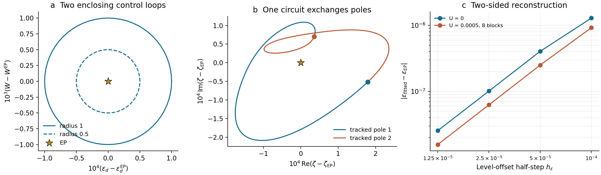

# Two-sided resonance-EP tests — 28 October 2026

The method succeeds at U = 0 and at selected finite-chain interacting EPs. The occupied interacting results are **not converged with bath length**. Pole splitting is **not evidence of lost causality**. No local-moment continuum EP has been established by this test.

## What was computed

The tested kernel is K(ζ) = (ζ − εd)I − Δb^II(ζ) − ΣU,N(ζ − μ), with fixed auxiliary coupling VO = 1.2134220096136235, remote energy 120, stationary rotation frequency 60, SOC parameter 0.05, and two real controls (εd, W). ζ is absolute complex energy. The local retarded frequency is ζ − μ. Wilson mesh shifts are distinct dimensionless variables.

At U = 0 the bath is integrated analytically over the full radial interval. At U > 0 the interaction self-energy comes from exact finite-chain charge-sector responses, without NRG state truncation. A full-band logarithmic bath mapping is used, including auxiliary bands. G and Q are averaged before forming U Q G⁻¹ for multiple Wilson meshes. The states and interaction self-energy are recomputed at every control point. The result remains a finite-chain self-energy embedded into the analytic continuum bath; it is not the exact interacting continuum Green function.

Unless otherwise indicated, Λ = 1.5, the Wilson mesh shift is 0.5, and radial quadrature uses 512 nodes. A bath block contains two fermionic modes. The ground state is the zero-temperature grand-canonical ground state of the Hermitian rotating-frame reference, under the explicit equilibrium-state assumption. The mapping has 24 blocks available; only the first N are retained in each interacting calculation.

## Locating the EP from both sides

1. Solve F = det K = 0 and ∂ζF = 0 independently in the four real unknowns Re ζ, Im ζ, εd, W.
2. Start the two-sided fit away from that center, by (δεd, δW) = (4×10⁻⁵, −3×10⁻⁴). At each iteration solve the two distinct poles at positive and negative offsets along each of the two control axes.
3. Form the branch-label-independent squared separation D = (ζ₊ − ζ₋)². Fit its two real components and update both controls. Halve both offsets at each of four iterations, from (10⁻⁴, 10⁻³) to (1.25×10⁻⁵, 1.25×10⁻⁴).
4. Independently check the recovered double zero, a rank-one 2×2 kernel, nonzero ∂ζ²F, derivative-step refinement, and two open cuts.
5. Track both poles around an ellipse with half-widths (10⁻⁴, 10⁻³), then halve the ellipse and increase the sampling from 64 to 128 intervals. Test winding, half-winding, pole exchange, assignment resolution, and unchanged reference ground charge along each contour.

This is a local numerical verification, not an interval-arithmetic proof or a global search for every EP. The pair finder uses the local critical point ∂ζF = 0 only to seed distinct roots; the roots are then refined against the full determinant. In the full causal model, the two offsets are not assumed to be exact PT-unbroken and PT-broken phases.

## Noninteracting benchmark

The recovered EP is ζ = 0.011972834346 -0.002807216274 i, εd = 0.015170349783, W = 0.100000000000. The two-sided estimate approaches the independent center, with approximately fourfold error reduction per halving after the initial step. The final double-zero refinement agrees to about 10⁻¹⁴ in the controls. The enclosing contour gives squared-separation winding −1, separation half-winding −1/2, and pole exchange. This sign refers to the chosen (εd, W) contour orientation and need not match a contour using (εd, VO).

## Occupied finite-chain candidates and bath dependence

The following centers are at U = 0.0005 and μ = 0.012. All pass the local double-zero/rank checks. Both the six- and eight-block centers also pass the two-sided reconstruction and both refined enclosing-loop tests. The ten-block center and the mesh/quadrature refinements were checked for double zeros but were not subjected to another full contour run.

| Bath | Re ζ | Im ζ | εd | W | nd | Double occupancy |
|---|---:|---:|---:|---:|---:|---:|
| 6 blocks | 0.011903167 | -0.0043803589 | 0.016204552 | 0.12234042 | 1.418855 | 0.478183 |
| 8 blocks | 0.013184494 | -0.0050121865 | 0.018197601 | 0.13144545 | 0.7744423 | 0.090188015 |
| 10 blocks | 0.010220821 | -0.0030233545 | 0.013297039 | 0.10121308 | 1.2380217 | 0.35145123 |
| 8 blocks, two shifts | 0.013219875 | -0.0049872941 | 0.01821231 | 0.13119389 | 0.77297815 | 0.090664453 |
| 8 blocks, 2048 radial nodes | 0.013190138 | -0.0050097435 | 0.018201302 | 0.13142202 | 0.77358136 | 0.089911725 |


The large changes from six to eight to ten blocks rule out a claim of bath convergence. The smaller changes upon two-mesh averaging and quadrupling radial nodes on eight blocks do not repair the chain-length dependence. These candidates are mixed-valence states, with significant empty or double-occupancy probability, rather than established screened local moments. A small U is not sufficient evidence of a correlated regime even if nd happens to approach one.

For the eight-block EP, |F| = 1.9e-18, |∂ζF| = 1.86e-15, and the kernel singular values are [0.0019399573171966548, 9.806930744676374e-16]. The magnitude of ∂ζ²F is about 1.66227. Halving the bath derivative step changes ∂ζ²F by a relative 1.74e-08. Both loops give winding −1 and exchange the poles. These small algebraic residuals describe accuracy within the chosen embedding, not its error relative to the continuum interacting problem.



In panel b, a single control circuit exchanges the endpoints of the two tracked branches; each individual branch is not required to close after one circuit. The circles mark their starting points. The star is the independently computed double pole.

## Low-filling comparison

At U = 0.0025, μ = 0 and twelve blocks, the retuned center is ζ = 0.011694997491 -0.001942568808 i, εd = 0.013987675682, W = 0.084257638953, with nd = 0.024176841. It passes the double-zero, two-sided, and both enclosing-loop tests. This is nontrivial finite-chain evidence at low filling, not a local-moment result.

A six-block μ = 0 control calculation gave nd = 0 and exactly zero interaction self-energy throughout the attempted U range. Its unchanged EP is a vacuum result and must not be cited as interaction robustness. Some continuation branches later stopped or failed a solver/check criterion. Those failures do not establish global EP absence or an interaction-driven destruction threshold. They do not exhaust other sheets, controls, or parameter regions.

## Pole splitting and causality

Distinct resonance poles in the lower half-plane describe distinct decaying modes. At an EP they coalesce. Interaction-induced splitting at fixed controls can coexist with a causal, passive physical retarded response.

The physical-sheet checks evaluate Γtot = i[(Δb + ΣU) − (Δb + ΣU)†] and Ad = −(G − G†)/(2πi). A negative spectral eigenvalue or an upper-half-plane physical-sheet singularity would require investigation; a split lower-half-plane resonance pair is not such a failure. Resonance-sheet pole positions alone do not prove physical-sheet causality.

We sampled 89 frequencies between −0.3 and 0.3 relative to μ, more densely near zero, at η = 10⁻⁵, 3×10⁻⁴ and 3×10⁻³. This is a finite-grid check, not a whole-axis or upper-half-plane theorem. All four cases passed:

- EP: all 267 sampled points passed; smallest rate eigenvalue 5.989e-08, smallest spectral eigenvalue 3.434e-05.
- minus_level_offset: all 267 sampled points passed; smallest rate eigenvalue 5.989e-08, smallest spectral eigenvalue 3.436e-05.
- plus_level_offset: all 267 sampled points passed; smallest rate eigenvalue 5.989e-08, smallest spectral eigenvalue 3.432e-05.
- occupied_strong_U_reference: all 267 sampled points passed; smallest rate eigenvalue 7.152e-08, smallest spectral eigenvalue 2.01e-05.

The strongly occupied reference uses U = 0.2, μ = 0.012, εd = 0.0151703497834 − U/2 and W = 0.1 on eight blocks. It has nd ≈ 0.994455 and double occupancy ≈ 0.001811. Passing these physical-axis checks establishes neither a resonance EP there nor bath convergence or Kondo screening.

## Supported conclusion

Two-sided pole tracking provides a reliable local diagnostic of the known U = 0 EP and selected finite-chain embedded EPs. It removes the need to resolve exactly coalesced poles during tracking. It does not remove errors in the bath discretization or in the interacting self-energy. The present occupied branch remains too dependent on bath length to support a continuum local-moment EP claim. A failed retuning or split poles at one parameter point also do not prove that interactions destroy every accessible EP.

No manuscript or public repository was changed. All new numerical statements in this note are grounded in the JSON files in `results/`. `ep_centers.csv` is a compact center/filling table; the scripts and logs are included.

## Reproduction

Python dependencies: NumPy, SciPy, Matplotlib. The adjacent `../solver/` directory contains the underlying exact solver and bath routines.

```bash
export OPENBLAS_NUM_THREADS=1 OMP_NUM_THREADS=1 MKL_NUM_THREADS=1
python3 two_sided_ep.py --name u0_method --U 0 --certify
python3 two_sided_ep.py --name occupied_n8_z1 --mu .012 --N 8 --U 0,.0005,.001,.0025,.005
python3 verify_selected.py --name cert_occ8 --source occupied_n8_z1.json --U .0005 --N 8 --topology
python3 check_causality.py
python3 build_report.py
```

`build_report.py` additionally uses the other recorded result files supplied in this package. Larger exact interacting baths can become expensive even without a truncation error. The provided results preserve unsuccessful continuation attempts and the vacuum control rather than silently omitting them.
